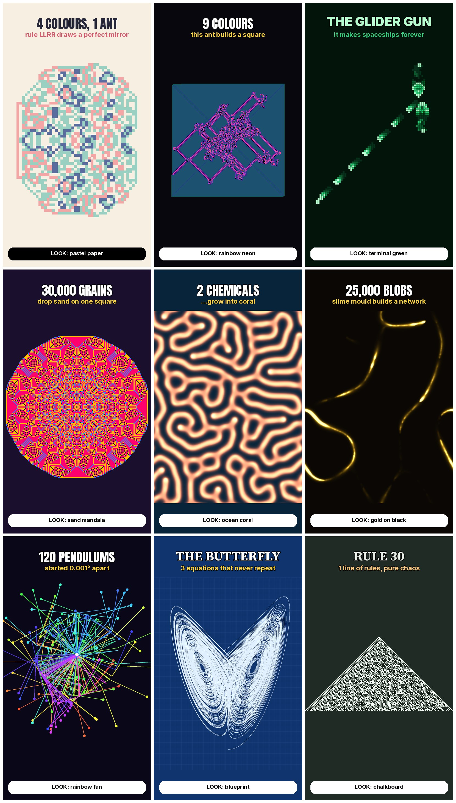

# Experiment ideas

Brainstormed with Dean (Oct 2026). All are free maths, so there's nothing to
license or get claimed. **Check every claim by running the simulation before
it goes in a script.** The notes below are what we expect, not verified facts.

## Season 1: the ant (each episode changes one thing)

| # | Experiment | Hook |
|---|---|---|
| 1 | Langton's Ant, 2 colours | Chaos, then a highway at step 9,977 (verified) |
| 2 | Add a 3rd colour (RLR) | Does it still find a highway? |
| 3 | 4 colours (LLRR) | Draws a mirror-symmetric pattern |
| 4 | Two ants on one grid | Do they help or wreck each other? |
| 5 | Put a wall or shape in its way | Can it escape? |
| 6 | 9 colours (LRRRRRLLR) | Builds a growing square |
| 7 | 100 ants | Chaos, or a pattern? |
| 8 | Give the ant a "mood" (turmites) | Spirals, ladders, odd shapes |
| 9 | The ant's cousin: Game of Life | Start of season 2 |

## Later seasons

**Grid rules**
- Game of Life in 3D: each generation stacks on top of the last, so a glider
  becomes a slanted tower.
- Sandpile: drop grains on one square; it topples into a fractal mandala.
- Rule 30: chaos used for random numbers.
- Rule 110: can in theory run any program.

**Numbers**
- Collatz: halve if even, 3x+1 if odd. Every number tested so far falls to
  1, and it's unproven that they all do. Shown as climbing towers, or a
  seaweed tree.
- Ulam prime spiral: diagonal lines appear.
- Pascal's triangle mod 2: a Sierpinski triangle appears.
- Golden-angle sunflower: at a slightly different angle it falls apart.

**Chance**
- Chaos game: random jumps make a Sierpinski triangle.
- Galton board: balls always pile into a bell curve.
- Random walks: in 2D you always get home; in 3D you might not.
- Buffon's needle: pi from dropped needles.
- Monty Hall, simulated 10,000 times.

**Chaos and physics**
- 100 double pendulums started 0.001° apart.
- Lorenz butterfly: suits an orbiting 3D camera.
- Three-body orbits.
- Pendulum wave: falls out of sync, then back into sync.

**Nature from maths**
- Gray-Scott reaction-diffusion (spots and stripes like animal skin), as a
  3D surface.
- Physarum slime mould networks.
- Boids flocking.
- Diffusion-limited aggregation (frost and lightning shapes).

## Looks tried (gallery)
- Pastel paper
- Rainbow neon
- Terminal green
- Sand mandala
- Ocean coral
- Gold on black
- Rainbow fan
- Blueprint
- Chalkboard

Idea: one look per season, so the channel varies but each series is
recognisable.
